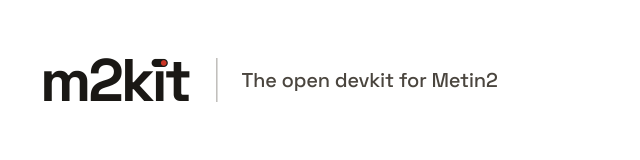
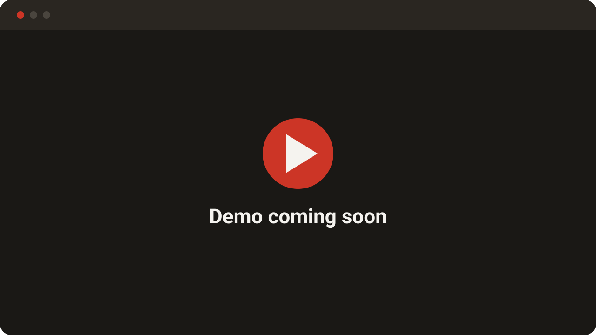

<a href="https://m2kit.dev">
  <picture>
    <source media="(prefers-color-scheme: dark)" srcset="https://raw.githubusercontent.com/m2kit/.github/HEAD/profile/assets/m2kit-readme-dark-theme.svg">
    <source media="(prefers-color-scheme: light)" srcset="https://raw.githubusercontent.com/m2kit/.github/HEAD/profile/assets/m2kit-readme-light-theme.svg">
    
  </picture>
</a>

One toolkit for Metin2 servers and mods. Start your own server, add features with mods you switch on and off in one click, and share your work with the community. No C++ required, no FreeBSD, and no more digging through old forums for code that may or may not work.

<!-- TODO: replace this placeholder with the demo GIF or short video. -->

## Why m2kit

- **Mods in one click.** Switch any mod on or off with one click or one command. Your game code stays untouched.
- **Bugs fixed, game modernized.** Get a 64-bit client on DirectX 9, many languages, offline shops and more.
- **A community mod catalog.** Find mods and share your own.
- **The same build on every machine.** The server and the client compile in prepared Docker images, so "it works on my machine" stops being a problem.
- **No experience needed.** Start without Linux or C++ knowledge. Add items, monsters, drops and more with JSON, and new game logic with Lua 5.4.
- **Safe by default.** Lua mods run in isolation, and unsigned packs with other code are blocked until you trust them.
- **Built for big projects.** Detailed documentation, developer tools, migrations, seeders, backups and tests keep your project under control.
- **A panel in your browser.** Connect to [panel.m2kit.dev](https://panel.m2kit.dev) to manage your servers.

## Who it is for

🖥️ **Server owners** who want to build, run and update a server from one place. 
🧩 **Mod authors** who want to write a mod once and share it. 
🛠️ **Core developers** who want to improve the server and the client.

## Support the project

m2kit is free to use. If it helps you, you can buy us a coffee to help.

## Author and contributors

Created by [@kwiatu-dev](https://github.com/kwiatu-dev), with help from [our contributors](https://github.com/m2kit/devkit/graphs/contributors).

## Get in touch

[contact@m2kit.dev](mailto:contact@m2kit.dev) · [m2kit.dev](https://m2kit.dev) · [Discord](https://discord.gg/hcMnCXTGnV)

---

m2kit is an independent community project. It is not affiliated with or endorsed by the owners or publishers of Metin2.
